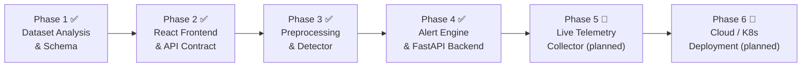

# Real-Time Microservice Monitoring, Anomaly Detection and Intelligent Alert Generation

Real-time microservice monitoring, statistical anomaly detection, intelligent alert aggregation, and incident correlation for the **Online Boutique microservice benchmark** (RE2-OB dataset — 90 real fault-injection cases from the RCAEval benchmark suite).

---

## Architecture Overview

```
                              ┌───────────────────────────────┐
                              │   RE2-OB Case Parquet Data    │
                              │ (metrics, logs, traces, inj)  │
                              └──────────────┬────────────────┘
                                             │
                                   [ Replay Engine ]
                                             │ (stream rows @ 1s)
                                             ▼
┌────────────────────────────┐            ┌────────────────────────────────┐
│ Live Prometheus Scraper    │ (Phase 5,  │  Preprocessing & Detector      │
│ (cAdvisor, node-exporter)  │  planned)──▶  (ZScore-max-7.0 baseline)    │
└────────────────────────────┘            └──────────────┬─────────────────┘
                                                         │ Anomaly Event
                                                         ▼
                                           ┌─────────────────────────────────┐
                                           │         Alert Engine            │
                                           │  1. Cooldown Deduplication      │
                                           │  2. Severity Scoring            │
                                           │  3. Log/Trace Enrichment        │
                                           │  4. Service Graph Grouping      │
                                           └───────────────┬─────────────────┘
                                                           │
                       ┌───────────────────────────────────┴─────────────────────────────────┐
                       ▼                                                                       ▼
          ┌────────────────────────────┐                               ┌──────────────────────────────┐
          │   SQLAlchemy Models        │                               │      FastAPI App              │
          │  (SQLite Development)      │                               │   REST + SSE Stream           │
          │ Services, Anomalies,       │                               │ /api/services, alerts         │
          │   Alerts, Incidents        │                               │ /api/events (SSE)             │
          └────────────────────────────┘                               └──────────────┬───────────────┘
                                                                                       │
                                                                                       ▼
                                                                       ┌──────────────────────────────┐
                                                                       │     React Dashboard           │
                                                                       │  (VITE_API_BASE_URL)          │
                                                                       └──────────────────────────────┘
```

---

## Development Phases



### Phase 1 — Dataset Analysis & Schema ✅

Explored all 90 cases of the RE2-OB benchmark (RCAEval). Built `metric_schema.yaml` mapping each parquet column to its service, unit and category. Derived the labelling rule: rows with `t ≥ t_inject` are anomalous; rows with `t < t_inject` are normal. Split 66 cases for training (73.3%) and 24 cases strictly held-out for evaluation, stratified by fault type.

📄 [`data-analysis/`](data-analysis/)

### Phase 2 — React Frontend & API Contract ✅

Built the full React + Vite monitoring dashboard with mock data so the UI could be developed independently of the backend. Defined the REST and SSE API contract (`docs/api_contract.md`) agreed between frontend and backend teams before any server code was written.

📄 [`docs/api_contract.md`](docs/api_contract.md) · [`src/`](src/)

### Phase 3 — Preprocessing, Detectors & Evaluation ✅

Implemented a leak-free time-series preprocessing pipeline (loader → cleaner → feature extractor → splitter) and evaluated four detector families (Rolling Z-Score, Isolation Forest, One-Class SVM, Local Outlier Factor) against the 24 held-out cases. **Selected detector: ZScore-max-7.0** — see [Results](#results) below.

📄 [`docs/reports/phase3_detector_evaluation.md`](docs/reports/phase3_detector_evaluation.md) · [`backend/preprocessing/`](backend/preprocessing/) · [`backend/detection/`](backend/detection/)

### Phase 4 — Alert Engine, Database & FastAPI Backend ✅

Implemented the full alert pipeline: cooldown deduplication, severity scoring (memory/disk/loss faults get higher severity), log & trace enrichment, and topological service-graph grouping. Wired everything into FastAPI with REST endpoints and a Server-Sent Events stream. Added a historical replay engine that streams any of the 90 RE2-OB cases at configurable speed (up to 100×) through the live pipeline.

📄 [`backend/alerts/`](backend/alerts/) · [`backend/app/`](backend/app/)

### Phase 5 — Live Telemetry Collector 🔲 *(planned)*

Replace the replay engine with a real Prometheus scraper pulling cAdvisor and node-exporter metrics from a running Online Boutique deployment (Docker Compose or Kubernetes). The preprocessing and detector layers will remain unchanged.

### Phase 6 — Cloud / Kubernetes Deployment 🔲 *(planned)*

Containerise all services and deploy to a managed Kubernetes cluster. Add Helm charts, horizontal scaling for the FastAPI workers, and a persistent PostgreSQL store replacing SQLite.

---

## Results

**Selected detector: `ZScore-max-7.0` — Instantaneous Rolling Z-Score, threshold 7.0 σ**

Evaluated on 24 strictly held-out RE2-OB fault-injection cases (never seen during training).

| Metric | Value |
|---|---|
| Precision | **76.1 %** |
| Recall (point-wise) | **46.6 %** |
| F1 Score | **0.512** |
| False Alarm Rate (FPR) | **3.8 %** |
| Mean Detection Delay | **26.2 seconds** |

### Full Detector Comparison

Eight detector configurations were evaluated — four statistical Z-Score variants and three scikit-learn ML models (Isolation Forest, One-Class SVM, Local Outlier Factor):

| Detector | Threshold / Tuning | Precision | Recall | F1 | FPR | Delay | Status |
|---|---|---|---|---|---|---|---|
| **ZScore-max-7.0** | max \|z\| > 7.0 (Instantaneous) | **0.761** | **0.466** | **0.512** | **3.8 %** | **26.2 s** | **✅ Selected** |
| ZScore-max-10.0 | max \|z\| > 10.0 (Instantaneous) | 0.779 | 0.400 | 0.442 | 1.9 % | 55.5 s | Viable High-Precision |
| ZScore-mean-2.0 | mean \|z\| > 2.0 (Instantaneous) | 0.615 | 0.261 | 0.294 | 0.9 % | 39.1 s | Low Sensitivity |
| ZScore-mean-2.5 | mean \|z\| > 2.5 (Instantaneous) | 0.541 | 0.228 | 0.257 | 0.8 % | 43.6 s | Conservative |
| ZScore-max-3.0 | max \|z\| > 3.0 (Standard) | 0.500 | 1.000 | 0.667 | 100 % | 0.0 s | Over-sensitive |
| **Isolation Forest** | contamination = 0.10 / 0.20 | 0.500 | 1.000 | 0.667 | 100 % | 0.0 s | Over-sensitive |
| **One-Class SVM** | RBF kernel, ν = 0.10 | 0.500 | 1.000 | 0.667 | 100 % | 0.0 s | Shift-sensitive |
| **Local Outlier Factor** | k = 20, novelty mode | 0.500 | 1.000 | 0.667 | 100 % | 0.0 s | Over-sensitive |

### Why ZScore-max-7.0 over Isolation Forest, One-Class SVM and LOF?

The three scikit-learn ML models (Isolation Forest, One-Class SVM, Local Outlier Factor) all saturated at **F1 = 0.667 and FPR = 100 %**, with a detection delay of 0.0 s. They classified *every* evaluation window as anomalous. The root cause: different RE2-OB runs have slightly different baseline operating points (e.g., `adservice` uses ~150 MB in one run and ~170 MB in another). A single global model fitted on a pooled multi-run feature space sees each individual run as a distributional outlier, producing a trivial "always-alarm" predictor.

The per-service rolling Z-Score normalises each metric relative to its own pre-fault training window, so inter-run drift does not create false alarms. A lower threshold (3.0 σ) also over-fires (FPR 100 %), while `ZScore-max-7.0` gives the best operational balance.

### Per-fault breakdown (ZScore-max-7.0)

| Fault | Cases | Precision | Recall | F1 | FPR | Mean Delay |
|---|---|---|---|---|---|---|
| Memory pressure (`mem`) | 4 | 97.1 % | 82.1 % | 0.882 | 2.4 % | 7.0 s |
| Disk I/O stress (`disk`) | 4 | 83.0 % | 75.0 % | 0.729 | 9.0 % | 8.0 s |
| Packet loss (`loss`) | 4 | 93.3 % | 70.4 % | 0.790 | 4.3 % | 50.0 s |
| Socket exhaustion (`socket`) | 4 | 83.4 % | 48.0 % | 0.589 | 3.0 % | 11.2 s |
| CPU saturation (`cpu`) | 4 | 55.5 % | 2.6 % | 0.050 | 2.2 % | 10.2 s |
| Network delay (`delay`) | 4 | 44.6 % | 1.7 % | 0.032 | 1.9 % | 70.8 s |

Memory, disk and packet-loss faults produce sharp 7 σ+ spikes that are flagged within 7–8 s of injection. CPU saturation and network delay cause sustained plateaus near 4–6 σ; the point-wise recall drops later in the fault window, but the Alert Engine's cooldown grouping sustains the active incident across the full duration.

📄 Full report: [`docs/reports/phase3_detector_evaluation.md`](docs/reports/phase3_detector_evaluation.md)

---

## Project Structure

> **Note**: The React frontend lives at the repository root (`src/`, `public/`, `package.json`, `vite.config.js`), not in a separate `frontend/` subdirectory.

```
├── backend/
│   ├── alerts/          # Deduplication, topological incident grouping, severity & enrichment
│   ├── app/
│   │   ├── api/         # FastAPI REST endpoints & Server-Sent Events stream
│   │   ├── db/          # SQLAlchemy models, SQLite session & initial service seeds
│   │   ├── events.py    # SSE broadcaster hub
│   │   ├── main.py      # Application entrypoint & CORS middleware
│   │   └── replay.py    # Historical RE2-OB streaming engine
│   ├── detection/       # Rolling Z-score baseline, Isolation Forest, OCSVM, LOF detectors
│   ├── preprocessing/   # Data loader, cleaner, sliding-window feature extractor, splitters
│   ├── requirements.txt # Python dependencies
│   └── tests/           # 46 automated unit and integration tests (pytest + httpx)
├── src/                 # React + Vite dashboard (Pages, Components, Recharts, Lucide)
├── public/              # Static assets
├── data/raw/            # RE2-OB benchmark parquet datasets (excluded from git, ~880 MB)
├── data-analysis/       # Evaluation reports and benchmark JSON outputs
├── docs/                # API contract, Phase 3 evaluation report
├── package.json         # Frontend configuration (at repo root)
├── vite.config.js       # Vite build config
└── .gitignore
```

---

## Getting Started

### Prerequisites

- **Python 3.14** (the `.venv` was created with 3.14; scikit-learn and pyarrow wheels are available for 3.14+)
- **Node.js 18+** and **npm**

### 1. Clone & set up the Python environment

```bash
git clone https://github.com/Sabia-12/Real-Time-Microservice-Monitoring-Anomaly-Detection-and-Intelligent-Alert-Generation.git
cd Real-Time-Microservice-Monitoring-Anomaly-Detection-and-Intelligent-Alert-Generation

python -m venv .venv
# Linux / macOS:
source .venv/bin/activate
# Windows (PowerShell):
.\.venv\Scripts\Activate.ps1

pip install -r backend/requirements.txt
```

### 2. Download the RE2-OB dataset

The dataset is hosted on HuggingFace Hub and is downloaded automatically by the loader:

```bash
python -c "from backend.preprocessing.loader import download_re2ob_dataset; download_re2ob_dataset()"
```

This places the 90 parquet cases in `data/raw/` (~880 MB). The folder is excluded from git by `.gitignore`.

### 3. Run the backend

```bash
uvicorn backend.app.main:app --host 127.0.0.1 --port 8000 --reload
```

- Interactive API docs: `http://localhost:8000/docs`
- Health check: `http://localhost:8000/api/health`

### 4. Run the frontend

```bash
npm install
npm run dev
```

- Dashboard: `http://localhost:5173`
- The dashboard reads `VITE_API_BASE_URL` from `.env` (defaults to `http://localhost:8000`).

### 5. Run the test suite

```bash
pytest backend/tests -v
```

46 tests pass (27 Phase 3 preprocessing/detector unit tests + 19 Phase 4 API/alert integration tests).

### 6. Stream a historical replay

Replay any of the 90 RE2-OB cases through the live pipeline at configurable speed:

```bash
curl -X POST "http://localhost:8000/api/replay/start?case_id=re2ob_checkoutservice_cpu_1&speed=10"
```

Live updates appear in the dashboard via Server-Sent Events (SSE) in real time.
